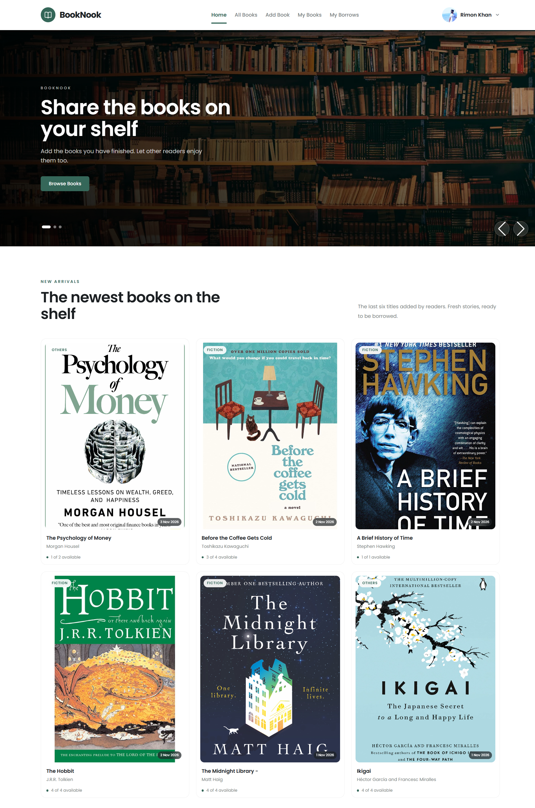

# BookNook 📚

BookNook is an online book management and borrowing platform where users can explore books, add their own books, and manage their borrowing activities. It provides a user-friendly experience for book lovers to discover and manage their favorite books.

## 🌐 Live Website

[Visit BookNook](https://booknook-client-blond.vercel.app/)

## 📸 Project Screenshot



## 🔗 Project Repositories

- **Client Repository:** [BookNook Client](https://github.com/mahzamincodes/PH-B14-A08-BookNook-Client)
- **Server Repository:** [BookNook Server](https://github.com/mahzamincodes/PH-B14-A08-BookNook-Server)

## ✨ Features

- **User Authentication:** Register and log in using email and password or Google authentication.
- **Browse Books:** Explore available books and filter them by category.
- **Book Details:** View detailed information about individual books.
- **Add Books:** Add new books with cover images and relevant information.
- **Manage My Books:** Edit or delete books added by the logged-in user.
- **Borrow Books:** Borrow available books and prevent duplicate borrowing.
- **My Borrows:** View borrowed books along with borrowing and return dates.
- **Return Books:** Return borrowed books and automatically update available copies.
- **Protected Routes:** Secure private pages and backend APIs using authentication and JWT verification.
- **Responsive Design:** Enjoy a smooth browsing experience on desktop, tablet, and mobile devices.

## 🛠️ Technologies Used

### Frontend
- Next.js
- React
- JavaScript
- Tailwind CSS
- shadcn/ui
- Better Auth

### Backend
- Node.js
- Express.js
- MongoDB
- JWT (Jose)
- Multer
- ImgBB API

## ⚙️ Run Locally

### 1. Clone the Frontend Repository

```bash
git clone https://github.com/mahzamincodes/PH-B14-A08-BookNook-Client.git
cd PH-B14-A08-BookNook-Client
```

### 2. Install Dependencies

```bash
npm install
```

### 3. Configure Environment Variables

Create a `.env` file in the frontend root directory and configure the required Better Auth, MongoDB, Google OAuth, and backend API URL environment variables.

### 4. Start the Frontend

```bash
npm run dev
```

Open [http://localhost:3000](http://localhost:3000) in your browser.

### 5. Set Up the Backend

Clone the backend repository:

```bash
git clone https://github.com/mahzamincodes/PH-B14-A08-BookNook-Server.git
cd PH-B14-A08-BookNook-Server
npm install
```

Configure the backend `.env` file with the required MongoDB credentials, ImgBB API key, Better Auth URL, and client URL.

Start the backend:

```bash
npm start
```

The backend runs on port `5000` by default.

## 👨‍💻 Developer

Developed by **Mahzamin Khan** as part of Programming Hero Assignment 08.
